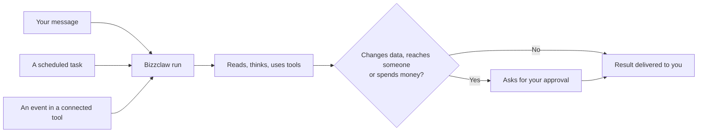

Every piece of work in Bizzclaw goes through the same path, whether it starts with your message, a schedule or an event in one of your tools.

## The pieces

<AccordionGroup>
  <Accordion title="Your assistant" icon="user">
    One assistant per account, built around you: your business, your people, your preferences and how you like things done. It picks up where you left off, in any channel.
  </Accordion>
  <Accordion title="Runs" icon="play">
    Each request becomes a run. A run can take many steps: read your calendar, check a deal, search the web, draft a message. You get the result in the same chat you asked from.
  </Accordion>
  <Accordion title="Tools and connections" icon="plug">
    Bizzclaw acts through the tools you connect (calendar, email, CRM, docs, issue trackers) plus built-in ones like a browser for web research and a CRM for people and deals. See [Connections](/connections/overview).
  </Accordion>
  <Accordion title="Memory" icon="brain">
    It keeps notes about you and the people and work you mention, and can search your past conversations. See [Memory](/concepts/memory).
  </Accordion>
  <Accordion title="Schedules and check-backs" icon="clock">
    Work doesn't have to start with you. Recurring tasks, one-off reminders and tasks triggered by events in your tools run on their own. See [Scheduled tasks](/concepts/scheduled-tasks).
  </Accordion>
  <Accordion title="Approvals" icon="shield-check">
    The same rules apply no matter how the work started. Risky steps always wait for you. See [Approvals](/concepts/approvals).
  </Accordion>
</AccordionGroup>

## Isolation

Each account's data, connections and memory are kept separate. Code the assistant runs (for example, to analyse a file) runs in an isolated sandbox that never receives your account credentials. See [Security & privacy](/security).
